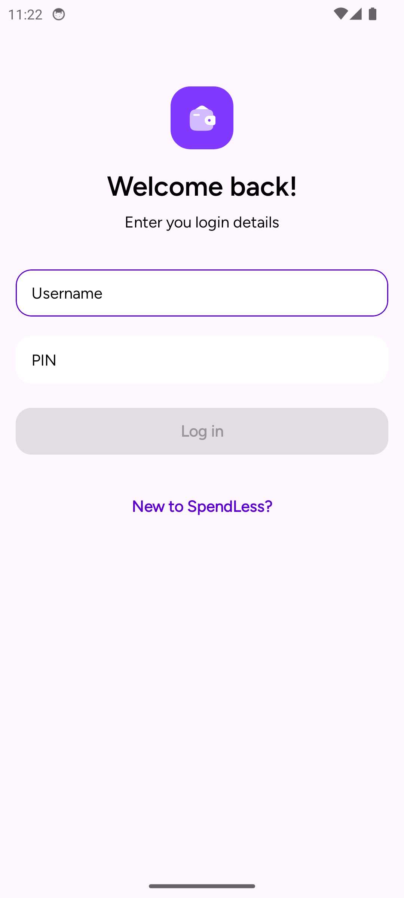
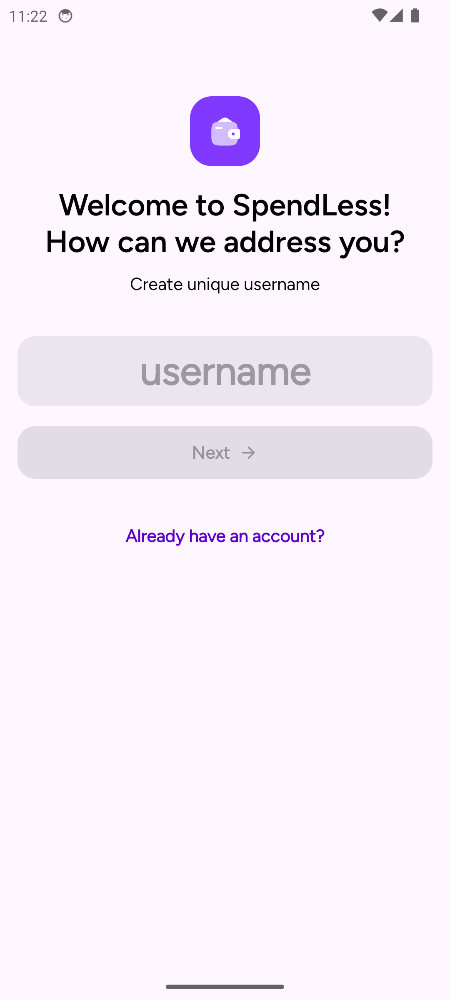
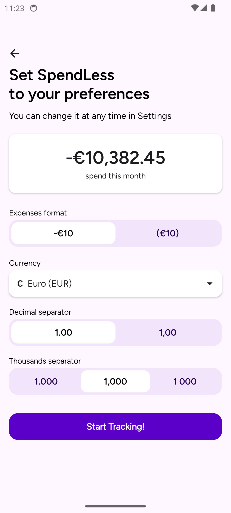
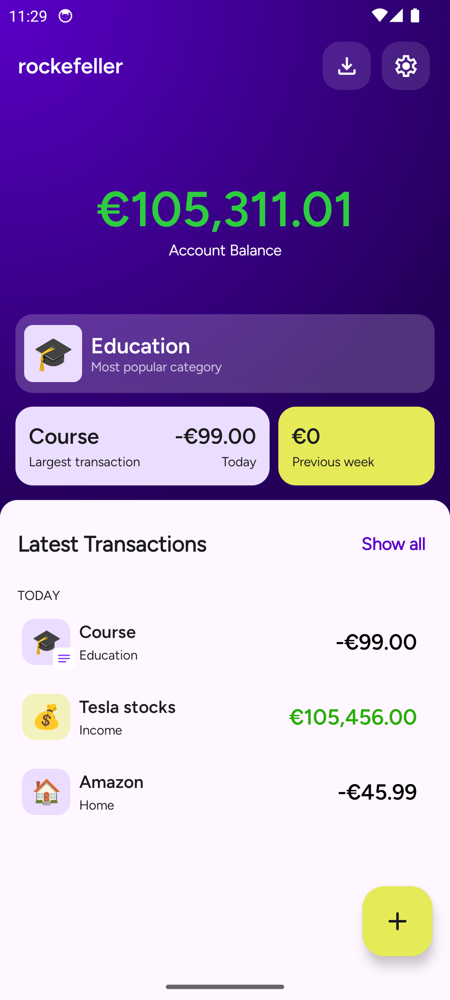
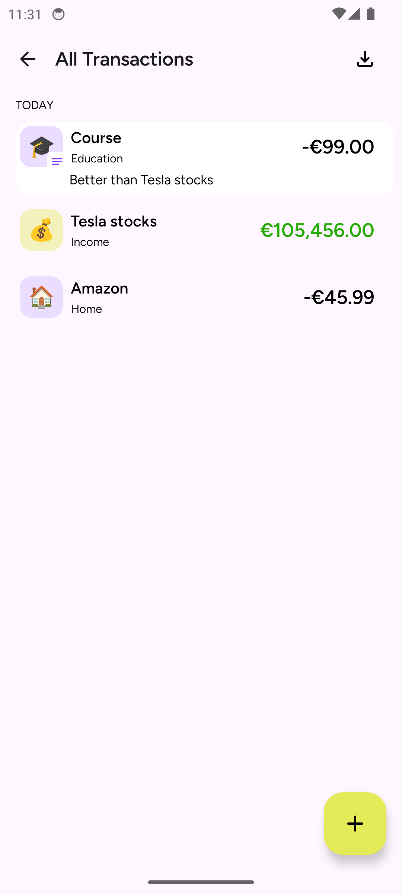
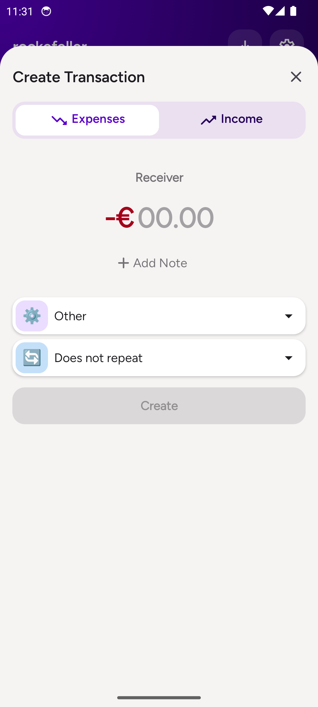
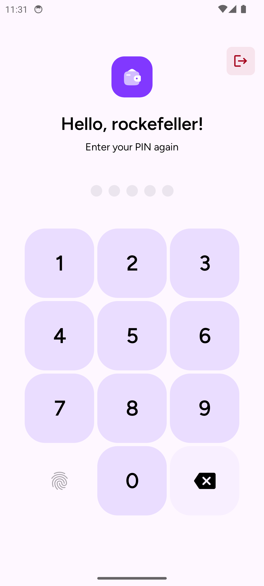
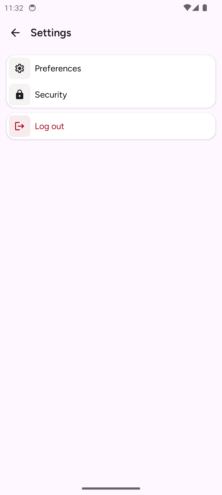
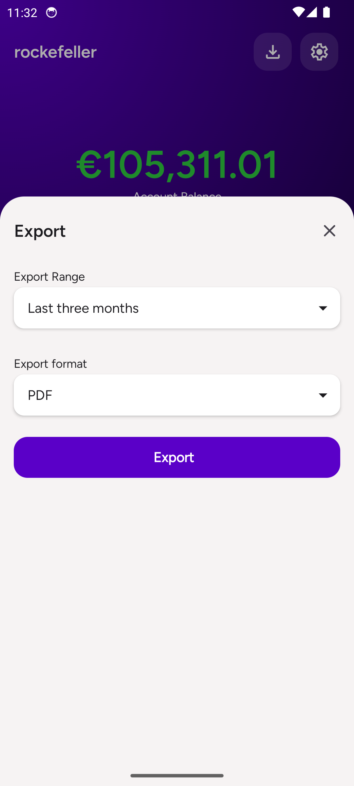

## SpendLess

A secure finance tracking Android app written in Kotlin using Jetpack Compose

## Screenshots

<table style="padding:10px">
  <tr>
    <td></td>
    <td></td>
    <td></td>
  </tr>

  <tr>
    <td></td>
    <td></td>
    <td></td>
  </tr>
  <tr>
    <td></td>
    <td></td>
    <td></td>
  </tr>
</table>

## Features

### Security
- PIN-based authentication with session management
- Biometric authentication support (fingerprint)
- Automatic session expiration (configurable duration)
- Account lockout after failed attempts
- Encrypted local data storage

### Transaction Management
- Track income and expenses
- Categorize transactions
- Set recurring transactions
- Add notes to transactions
- View transaction history

### Customization
- Configurable currency display formats
- Choice of decimal and thousands separators
- Expense display preferences (minus sign or parentheses)
- Multiple currency symbols supported

### Data Export
- Export transactions to CSV or PDF
- Filter by date ranges
- Save exports to device downloads folder

### Widget
- Simple widget shortcut to create transactiom

## Technical Implementation
- Android architecture components (Clean Architecture + MVI)
- Declarative UI with Jetpack Compose
- Compose Navigation with secure routing
- Data encryption using Android Keystore
- Local persistence with Room Database
- Kotlin Coroutines for asynchronous operations
- Material Design 3 components and theming
- Glance widget

## Getting Started

1. Clone the repository:
```sh
git clone https://github.com/galahseno/SpendLess.git
```
2. Open the project in Android Studio
3. Build and run the app on an emulator or physical device

## Requirements
Android 8.0 (API 26) or higher

Minimum SDK: 26

Target SDK: 34

## Configuration
The app can be configured through the Settings screen:
1. Change session timeout duration
2. Enable/disable biometric authentication
3. Customize currency display formats
4. Set lockout duration after failed attempts
